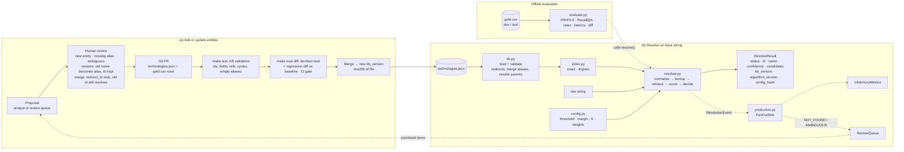
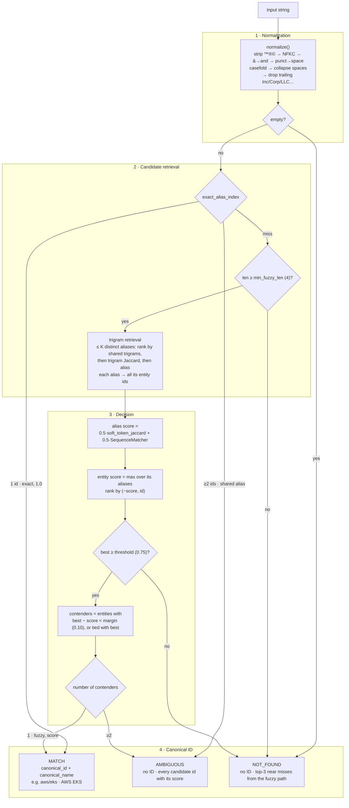

# Architecture

## Components and data flows

| Module | Responsibility |
|---|---|
| `config.py` | `ResolverConfig` (threshold, margin, K, weights) with validation; config hash and algorithm version |
| `normalize.py` | Technical normalization (`normalize`), including trailing legal-suffix stripping |
| `kb.py` | Loads and validates the KB; resolves redirect chains, merges stub aliases into the final target, rewrites `parent_id`s that name a stub; `lookup(id)` for old ids; computes the KB version |
| `index.py` | Builds `exact_alias_index` and `trigram_index` at load time |
| `retrieval.py` | At most K distinct alias strings, ranked by shared trigrams → trigram Jaccard → alias (strict cut) |
| `scoring.py` | Alias-level score: soft token Jaccard plus `SequenceMatcher` |
| `resolver.py` | Tier orchestration, max-per-entity aggregation, threshold and margin decision |
| `cli.py` | `techresolve` command: resolves names from arguments or stdin lines and prints JSON results (`--kb`, `--compact`) |
| `evaluation.py`, `scripts/evaluate.py` | Gold scoring rules, metrics, sweep, regression diff |
| `production.py` | `ResolutionEvent`, `MetricsSink` protocol, `InMemoryMetrics`, `ReviewQueue`, `FanOutSink` stubs |

## Resolution flow

Traced through the bundled KB:

| Input | Normalized | Path | Result |
|---|---|---|---|
| Amazon EKS | `amazon eks` | exact | MATCH `aws/eks` (1.0) |
| Okta, Inc. | `okta` | exact, legal suffix stripped | MATCH `okta/workforce-identity` (1.0) |
| Crowdstrik Falcon | `crowdstrik falcon` | fuzzy | MATCH `crowdstrike/falcon` (0.986) |
| Sentinel | `sentinel` | exact, shared alias | AMBIGUOUS `microsoft/sentinel`, `sentinelone/singularity` |
| FooBarDB | `foobardb` | fuzzy, below threshold | NOT_FOUND (best 0.20) |
